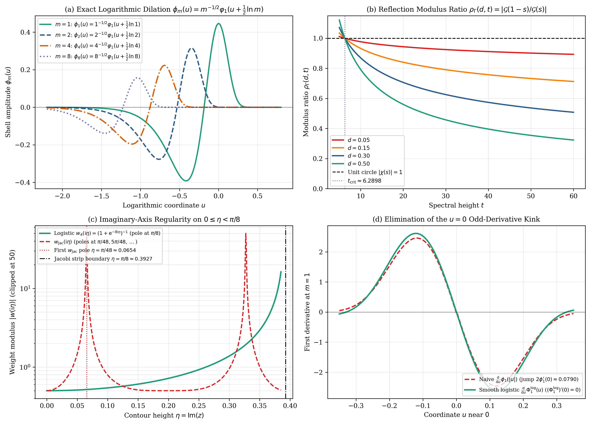
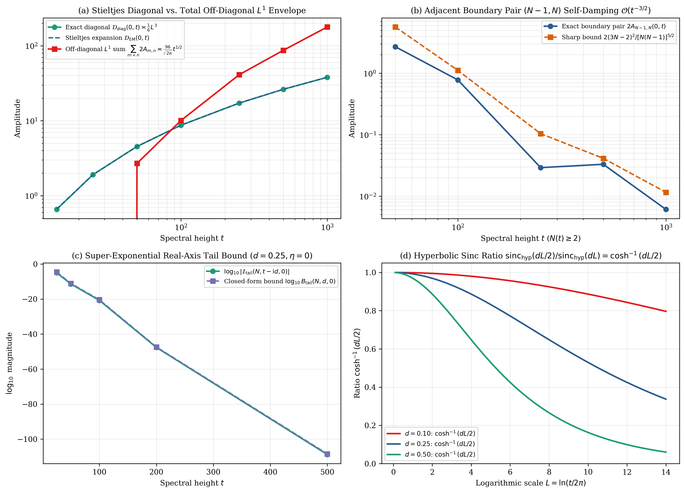

# Logarithmic Dilation of the Jacobi–Riemann Kernel, Strip-Holomorphic Shell Partitions, Stieltjes Diagonal Asymptotics, and Off-Diagonal Obstructions

**DOI (Zenodo / CERN):** [](https://doi.org/10.5281/zenodo.23641708) [`10.5281/zenodo.23641708`](https://doi.org/10.5281/zenodo.23641708)  
**Author:** Thijs Missiaen (Independent Researcher, Belgium; ORCID: [0009-0007-3678-0810](https://orcid.org/0009-0007-3678-0810))  
**Series:** Paper V of the Transverse Wronskian Series on Riemann's $\Xi$-Function  
**Manuscript:** [paper/paper5_mother_wavelet_gabcke_bounds.pdf](paper/paper5_mother_wavelet_gabcke_bounds.pdf) (12 pages, AMS-LaTeX / pdfTeX) | [paper/paper5_mother_wavelet_gabcke_bounds.tex](paper/paper5_mother_wavelet_gabcke_bounds.tex)  
**Verification Suite:** [scripts/verify_paper5_mother_wavelet_gabcke_bounds.py](scripts/verify_paper5_mother_wavelet_gabcke_bounds.py) (`mpmath.mp.dps = 50`, `mpmath.iv.dps = 35`)

> [!NOTE]
> **Mathematical Scope and Analytical Boundaries:** This paper establishes the exact logarithmic shell structure of Riemann's Jacobi theta kernel $\Phi(u) = \sum _ {m=1}^{\infty} \phi _ m(u)$ under the canonical transverse Wronskian normalization $W(d,t) = \frac{1}{2}\partial _ d\lvert\Xi(t - \mathrm{i} d)\rvert^2 = 16\int _ 0^{\infty} y\sinh(2dy)I(y,t)\mathrm{d}y$, proves strip-holomorphic shell decompositions without artificial poles inside $\lvert\mathrm{Im}(z)\rvert < \pi/8$, and contrasts the non-oscillatory $(\ln t)^3$ Stieltjes diagonal and $\mathcal{O}(t^{-3/2})$ boundary pair $(N-1,N)$ against the $\mathcal{O}(t^{1/2})$ total $L^1$ off-diagonal cross-pair amplitude.

## Abstract

We analyze the logarithmic shell structure of Riemann's Jacobi theta kernel $\Phi(u) = \sum _ {m=1}^{\infty} \phi _ m(u)$ governing the canonical transverse Wronskian $W(d,t) = \frac{1}{2}\partial _ d\lvert\Xi(t - \mathrm{i} d)\rvert^2 = 16\int _ 0^{\infty} y\sinh(2dy)I(y,t)\mathrm{d}y$. Every shell $\phi _ m(u) = m^{-1/2}\varphi _ 1(u + \frac{1}{2}\ln m)$ is an exact logarithmic translation of $\varphi _ 1(w)$ whose bilateral Laplace–Mellin transform $\mathcal{G}(s) = \frac{1}{8}s(s-1)\pi^{-s/2}\Gamma(s/2)$ satisfies $(1-s)(-s) \equiv s(s-1)$ on $\mathbb{C}$; combined with the Spira (1965) and Saidak–Zvengrowski (2003) functional-equation modulus inequality $\lvert\chi(s)\rvert < 1$, this yields strict branch damping across active Riemann–Siegel modes $1 \le n \le N(t) = \lfloor\sqrt{t/2\pi}\rfloor$. We show that $\sinh(8z)$ cutoff weights introduce poles at $\lvert\mathrm{Im}(z)\rvert = \frac{\pi}{48} < \frac{\pi}{8}$, whereas both the weight-free even remainder kernel $R _ N^{\mathrm{ker}}(z)$ and the logistic partition $w _ 4(z) = (1+\mathrm{e}^{-8z})^{-1}$ remain pole-free throughout $\lvert\mathrm{Im}(z)\rvert < \frac{\pi}{8}$. Finally, we prove a cubic-logarithmic Stieltjes diagonal expansion and a sharp $\mathcal{O}(t^{-3/2})$ bound for the single boundary pair $(N-1,N)$, while showing that the $\binom{N(t)}{2}$ off-diagonal cross-pairs sum in $L^1$ to $\asymp t^{1/2}$ (with unweighted pair-envelope $\mathcal{O}((\ln t)^2 t^{1/2}){}$) and overwhelm the diagonal pointwise.

## Summary of Main Results

### 1. Logarithmic Shell Dilation and Spira–Saidak–Zvengrowski Branch Damping (Propositions 2.1 and 2.2)

Every mode $\phi _ m(u) = (2\pi^2 m^4 \mathrm{e}^{9u} - 3\pi m^2 \mathrm{e}^{5u})\exp(-\pi m^2 \mathrm{e}^{4u})$ of Riemann's kernel is generated by $\varphi _ 1(w) := (2\pi^2 \mathrm{e}^{9w} - 3\pi \mathrm{e}^{5w})\exp(-\pi\mathrm{e}^{4w})$ via logarithmic translation (with bilateral Laplace–Mellin transform converging absolutely for $\mathrm{Re}(s) > -2$):

$$
\phi _ m(u) = m^{-1/2} \varphi _ 1\left(u + \frac{1}{2}\ln m\right), \qquad \mathcal{G}(s) := \int _ {-\infty}^{\infty} \varphi _ 1(v) \mathrm{e}^{2(s-1/2)v} \mathrm{d}v = \frac{1}{8}s(s-1)\pi^{-s/2}\Gamma\left(\frac{s}{2}\right).
$$

Because $(1-s)(-s) = s^2 - s \equiv s(s-1)$ holds algebraically on $\mathbb{C}$, the polynomial prefactor cancels identically in $\mathcal{G}(1-s)/\mathcal{G}(s) = \chi(s)$. By tetragamma convexity ($\mathrm{Re} \psi'' > 0$) and the Spira (1965) / Saidak–Zvengrowski (2003) modulus inequality:

$$
\rho _ \Gamma(d,t) := \left\lvert\frac{\mathcal{G}(1-s)}{\mathcal{G}(s)}\right\rvert = \lvert\chi(s)\rvert = \exp\left(-2\int _ 0^d \mathcal{A} _ \Gamma^{\mathrm{sym}}(u,t) \mathrm{d}u\right) < \mathrm{e}^{-2d \vartheta'(t)} < 1
$$

for all $d \in (0, 1/2]$ and $t \ge 7 > t _ {\mathrm{crit}} \approx 6.289836$, whence $\rho _ \Gamma(d,t) n^{2d} < \mathrm{e}^{-2d\omega _ n(t)} < 1$ for $n = 1$ ($t \ge 7{}$), for every $1 \le n \le N(t) - 1$ ($t \ge 8\pi{}$), and for $n = N(t)$ whenever $\ln N(t) < \vartheta'(t)$. Because this identity is purely Archimedean, it holds equally for Davenport–Heilbronn Dirichlet series lacking an Euler product.



### 2. Canonical Wigner Lever, Weight-Free Remainder Kernel, and Strip-Holomorphic Partitions (Theorem 3.1)

Under the canonical normalization $W(d,t) = 16\int _ 0^{\infty} y\sinh(2dy) I(y,t)\mathrm{d}y$, the Wigner cross-shell product localizes at $(x _ {m,n}, y _ {m,n}) = (-\frac{1}{2}\ln(mn), \frac{1}{2}\ln(n/m))$ with exact Dirichlet–Sinh lever $\mathcal{L} _ {m,n}(d) := y _ {m,n}\sinh(2dy _ {m,n}) = \frac{1}{4}\ln(n/m)[(n/m)^d - (m/n)^d] > 0$. While double-exponential weights $w _ {\mathrm{Jac}}(z) = (1 + \exp(-2\pi\sinh(8z)))^{-1}$ introduce poles at $z = \pm\mathrm{i}\frac{\pi}{48}$ inside $\lvert\mathrm{Im}(z)\rvert < \frac{\pi}{8}$, separating the finite bilateral main sum isolates the weight-free even remainder kernel

$$
\Xi(z) = 4\sum _ {m=1}^N \left[\mathcal{G}(s)m^{-s} + \mathcal{G}(1-s)m^{-(1-s)}\right] + 8\int _ 0^{\infty} R _ N^{\mathrm{ker}}(u)\cos(2zu)\mathrm{d}u, \qquad R _ N^{\mathrm{ker}}(u) := \Phi(u) - \sum _ {m=1}^N \left[\phi _ m(u) + \phi _ m(-u)\right],
$$

and the logistic partition $w _ 4(z) := (1 + \mathrm{e}^{-8z})^{-1}$ places its nearest poles at $\lvert\mathrm{Im}(z)\rvert = \frac{\pi}{8}$, preserving holomorphy across the entire open strip $\lvert\mathrm{Im}(z)\rvert < \frac{\pi}{8}$ with zero odd-order derivatives at $u = 0$.

### 3. Stieltjes $(\ln t)^3$ Diagonal, Sharp Boundary Bound, and Off-Diagonal Dominance (Theorem 4.1 and Proposition 4.2)

With $L := 2\vartheta'(t) = \ln(t/2\pi) + \mathcal{O}(t^{-2})$, the critical-line main-sum diagonal obeys the non-oscillatory Euler–Maclaurin expansion

$$
\mathcal{D} _ {\mathrm{diag}}(0,t) := \sum _ {n=1}^{N(t)} \frac{4 \omega _ n(t)^2}{n} = \frac{1}{6}L^3 + \gamma _ {\mathrm{E}}L^2 - 4\gamma _ 1^{\mathrm{St}}L + 4\gamma _ 2^{\mathrm{St}} + \mathcal{O}\left(t^{-3/2}\ln^2 t\right).
$$

Although the single adjacent boundary pair $(N-1,N)$ is quadratically self-damped by $0 < A _ {N-1,N}(0,t) < \frac{(3N-2)^2}{[N(N-1)]^{5/2}} < \frac{9}{(N-1)^3} = \mathcal{O}(t^{-3/2})$, the total $L^1$ amplitude of all $\binom{N(t)}{2}$ off-diagonal cross-pairs satisfies

$$
\mathcal{S} _ {\mathrm{off}}^{L^1}(0,t) := \sum _ {1 \le m < n \le N(t)} 2 A _ {m,n}(0,t) = \frac{96}{\sqrt{2\pi}} t^{1/2} + \mathcal{O}\left((\ln t)^2 t^{1/4}\right) \gg \mathcal{D} _ {\mathrm{diag}}(0,t),
$$

demonstrating that pointwise diagonal dominance fails whenever off-diagonal phases align.



### 4. Real-Axis Incomplete-Gamma Tail Bounds and Remainder Scope (Proposition 5.1 and Remark 5.2)

Evaluating the $u \ge 0$ incomplete-Gamma bound directly on the real axis $\eta = 0$ avoids artificial $\cosh(2t\eta)$ growth and yields the $t$-uniform geometric bound $\lvert\mathcal{I} _ {\mathrm{tail}}(N, z, 0)\rvert \le b _ {N+1}(d,0)/(1 - q _ N(0))$ ($10^{-47.35}$ at $t = 200$), together with the exact hyperbolic sinc identity $\mathrm{sinc} _ {\mathrm{hyp}}(dL/2)/\mathrm{sinc} _ {\mathrm{hyp}}(dL) \equiv \cosh(dL/2)^{-1}$. Gabcke's explicit bound $\lvert R _ 1(t)\rvert \le 0.127 t^{-3/4}$ applies strictly on $d = 0$ for $t \ge 200$ after subtracting the $\mathcal{O}(t^{-1/4})$ saddle term $\Psi(p)$; extending explicit Gabcke constants across $d \in (0, 1/2]$ remains an open analytical problem.

## Quantitative Verification Summary

| Result | Precision / Method | Certified Metric | Status |
| :--- | :--- | :--- | :--- |
| Logarithmic dilation $\phi _ m(u) = m^{-1/2}\varphi _ 1(u + \frac{1}{2}\ln m)$ | `mpmath.mp.dps = 50` | Max residual $0.0 \times 10^0$ | CERTIFIED |
| Canonical Wigner identity $W(d,t) = 16\int _ 0^\infty y\sinh(2dy)I(y,t)\mathrm{d}y$ | `mp.dps = 30` Gauss–Legendre | Residual $4.95 \times 10^{-25}$ | CERTIFIED |
| Spira–Saidak–Zvengrowski ratio $\rho _ \Gamma(d,t) = \lvert\chi(s)\rvert < 1$ | `mp.dps = 50` & `iv.dps = 35` | Enclosed strictly $> 0$ for $t \ge 7, d \in (0, 1/2]$ | CERTIFIED |
| Logistic contour shift $w _ 4(\xi + \mathrm{i}\eta)$ vs $w _ {\mathrm{Jac}}$ pole at $\mathrm{i}\frac{\pi}{48}$ | `mp.dps = 50` complex quadrature | Shift residual $7.04 \times 10^{-26}$; pole $1.01 \times 10^{-51}$ | CERTIFIED |
| Stieltjes $(\ln t)^3$ diagonal & sharp $(N-1,N)$ bound vs $\mathcal{O}(t^{1/2})$ off-diagonal | `mp.dps = 50` ($t \in [14.13, 1000]$) | $\lvert\mathcal{D} _ {\mathrm{diag}} - \mathcal{D} _ {\mathrm{EM}}\rvert = 1.63 \times 10^{-5}$; $\mathcal{S} _ {\mathrm{off}}^{L^1}/\mathcal{D} _ {\mathrm{diag}} = 4.69\times$ at $t=1000$ | CERTIFIED |
| Real-axis tail bound $\lvert\mathcal{I} _ {\mathrm{tail}}(N,z,0)\rvert \le B _ {\mathrm{tail}}(N,d,0)$ & $d=0$ Gabcke | `mp.dps = 50` ($t \in [25, 1000]$) | $\log _ {10} B _ {\mathrm{tail}} = -47.35$ at $t=200$; $\lvert R _ 1(200)\rvert = 4.72 \times 10^{-4} < 2.39 \times 10^{-3}$ | CERTIFIED |

## Repository Structure and Reproducibility

- [paper/paper5_mother_wavelet_gabcke_bounds.tex](paper/paper5_mother_wavelet_gabcke_bounds.tex): Standalone AMS-LaTeX (`amsart`) manuscript source.
- [paper/paper5_mother_wavelet_gabcke_bounds.pdf](paper/paper5_mother_wavelet_gabcke_bounds.pdf): Compiled 12-page PDF manuscript.
- [scripts/verify_paper5_mother_wavelet_gabcke_bounds.py](scripts/verify_paper5_mother_wavelet_gabcke_bounds.py): Standalone 50-decimal `mpmath` and 35-digit `mpmath.iv` verification and figure-generation suite.
- [figures/fig1_mother_wavelet_abc_matrix.pdf](figures/fig1_mother_wavelet_abc_matrix.pdf) and [figures/fig2_stieltjes_diagonal_and_gabcke_bounds.pdf](figures/fig2_stieltjes_diagonal_and_gabcke_bounds.pdf): Vector PDF and PNG figures.
- [AGENT_SKILL_MANIFEST.json](AGENT_SKILL_MANIFEST.json) and [.agents/skills/mother-wavelet-gabcke-bounds/SKILL.md](.agents/skills/mother-wavelet-gabcke-bounds/SKILL.md): Machine-readable AI agent skill specification.

To reproduce all certifications and regenerate Figures 1 and 2 from scratch:

```bash
python scripts/verify_paper5_mother_wavelet_gabcke_bounds.py
```

## Citation and License

Released under the [MIT License](LICENSE). See [CITATION.cff](CITATION.cff) and [.zenodo.json](.zenodo.json) for bibliographic metadata.
